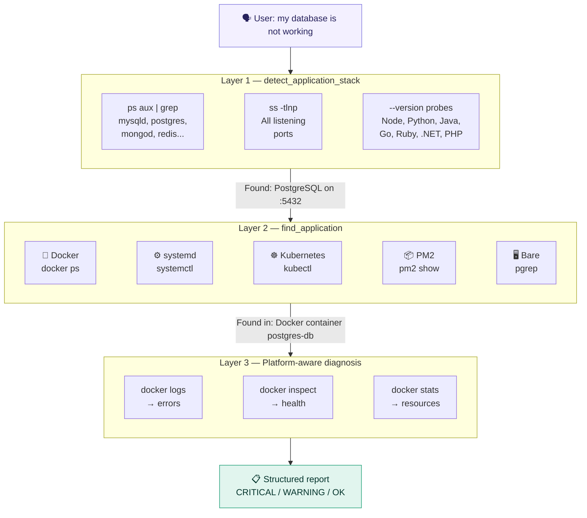
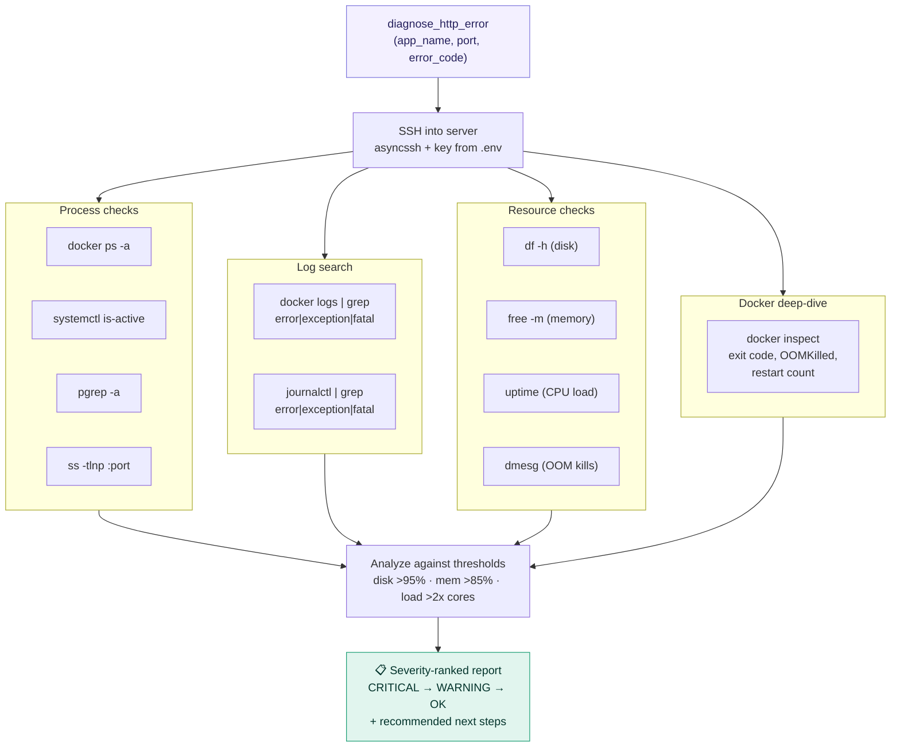

# InfraAgent


**Your AI Junior DevOps Engineer** — an MCP server that SSHes into any remote Linux server, auto-detects the runtime environment, and performs intelligent diagnostics like a junior DevOps engineer investigating production issues.

Built on the [Model Context Protocol (MCP)](https://modelcontextprotocol.io/) — designed to be used with Claude Desktop, Claude Code, or any MCP-compatible AI client.

## What Makes InfraAgent Different

Most server diagnostic tools expose individual commands. InfraAgent's **workflow tools** run full diagnostic decision trees — investigating issues the way a DevOps engineer would.

### Auto-detection: how it knows what's running

You say _"my database is not working"_ — you didn't specify the engine or how it runs. InfraAgent figures it out:



> **All probes in each layer run in parallel** via `asyncio.gather` — the full detection completes in 1-3 seconds, not minutes.

### Diagnostic workflow: what happens inside `diagnose_http_error`

When the AI calls `diagnose_http_error("my-api", 80, 500)`, InfraAgent fires **12 SSH commands simultaneously**:



## Features

### Junior DevOps Workflows (6 tools)
Smart diagnostic chains that run 5-15 checks in one call:
- **diagnose_http_error**: Full investigation for HTTP 4xx/5xx errors
- **diagnose_container_crash**: Why is my container dying? (exit codes, OOM, logs, resources)
- **diagnose_high_resource_usage**: Server slow? CPU/memory/disk bottleneck detection
- **diagnose_service_down**: Service not responding — find it, check it, diagnose it
- **diagnose_deployment_issue**: App won't start after deploy — port conflicts, env vars, permissions
- **diagnose_connectivity_issue**: Layer-by-layer analysis — DNS → port → TCP → SSL → firewall

### Runtime & Platform Detection (5 tools)
- **detect_runtime_environment**: Master detection — probes all platforms in parallel
- **detect_docker_environment**: Deep Docker probe (daemon, containers, Compose, Swarm)
- **detect_kubernetes_environment**: Kubernetes cluster, pods, services, deployments
- **detect_systemd_services**: Full systemd service inventory by state
- **detect_process_managers**: PM2, Supervisor, forever detection

### Application Stack & Diagnostics (5 tools)
- **detect_application_stack**: Auto-detect web servers, databases, caches, language runtimes
- **find_application**: Find an app across all platforms (Docker/systemd/k8s/PM2/process)
- **get_application_logs**: Get logs regardless of platform (auto-detect or explicit)
- **check_application_health**: Health check with resource usage and recent errors
- **find_application_errors**: Search for errors in app logs across platforms

### Smart Troubleshooting (5 tools)
- **full_system_health_scan**: One-shot health scan with OK/WARNING/CRITICAL flags
- **check_port_connectivity**: Port listening check, process owner, TCP + HTTP test
- **check_ssl_certificate**: SSL cert validity, expiry, issuer
- **find_error_patterns**: Search all log sources for error patterns
- **check_docker_compose_services**: Compose project detection and service status

### System Monitoring (18 tools)
- Disk usage, memory, CPU load, top processes
- Docker containers, logs, resource stats, container health
- Disk I/O, inode usage, path-level usage
- Network interfaces, connections, open ports
- Failed services, journal logs, kernel errors
- DNS resolution, recent logins

### Database & Service Management (4 tools)
- Read-only SQL queries against remote databases
- Service status checking and restart capability
- Docker container health checks

## Architecture

Single-file MCP server using PEP 723 inline script metadata. Dependencies are declared directly in `server.py`, so no separate `pyproject.toml` is needed. `uv` automatically installs dependencies when you run the script.

## Prerequisites

- Python 3.10 or higher
- [uv](https://github.com/astral-sh/uv) package manager
- SSH access to the target server with key-based authentication
- Claude Desktop or any MCP-compatible client

## Setup

### 1. Install uv (if not already installed)

```bash
curl -LsSf https://astral.sh/uv/install.sh | sh
```

### 2. Configure Environment Variables

Copy the example environment file and fill in your server details:

```bash
cp .env.example .env
```

Edit `.env` with your server information:

```env
# Required: SSH connection
SSH_HOST=your-server-ip
SSH_USER=your-ssh-user
SSH_KEY_PATH=~/.ssh/id_ed25519

# Optional: Database tools (if your app uses MariaDB/MySQL)
DB_HOST=your-database-host
DB_PORT=3306
DB_USER=app_user
DB_PASS=your-database-password
DB_NAME=app_db
```

### 3. Test SSH Connection

Ensure you can connect to your server without a password:

```bash
ssh your-user@your-server-ip
```

### 4. Test the Server

```bash
uv run server.py
```

The server will start and wait for stdio input. Press Ctrl+C to stop.

### 5. Configure Claude Desktop

Add InfraAgent to Claude Desktop's configuration:

**macOS**: `~/Library/Application Support/Claude/claude_desktop_config.json`
**Windows**: `%APPDATA%\Claude\claude_desktop_config.json`

```json
{
  "mcpServers": {
    "infra-agent": {
      "command": "uv",
      "args": [
        "--directory",
        "/path/to/server-mcp",
        "run",
        "server.py"
      ]
    }
  }
}
```

### 6. Restart Claude Desktop

Quit and restart Claude Desktop for changes to take effect.

## Usage Examples

### Workflow Diagnostics (the smart tools)
- "I'm getting 500 errors on my API — diagnose it"
- "My Docker container keeps crashing — why?"
- "The server feels slow — what's the bottleneck?"
- "My service isn't responding on port 8080 — investigate"
- "I just deployed and the app won't start — help"
- "I can't reach my service from outside — check connectivity"

### General Diagnostics
- "Connect to my server and tell me what's running"
- "Is my app healthy? Check nginx"
- "Run a full system health scan"
- "Why are there errors? Check the last hour"
- "What runtime platforms are on this server?"
- "Find where my-app is running — Docker, systemd, or something else?"
- "Check the SSL certificate for mail.example.com"
- "Show me which Docker Compose projects are running"

## Security

### Read-Only by Design
- 42 of 43 tools are read-only and cannot modify server state
- The only mutating tool (`restart_service`) is clearly marked in its docstring

### Input Validation
- All user-provided inputs are validated and sanitized
- Shell commands use `shlex.quote()` for injection prevention
- Log search patterns use an allowlist (not free-form input)
- SQL queries use strict command allowlists
- Service names, container names, and hostnames validated with regex

### SSH Security
- Uses SSH key authentication (no passwords)
- Set `known_hosts=None` accepts any host key (consider adding known_hosts for production)

### Environment Variables
- Never commit `.env` to version control (listed in `.gitignore`)

## Troubleshooting

### Server doesn't appear in Claude Desktop
1. Check the path in `claude_desktop_config.json`
2. Verify JSON syntax is valid
3. Check Claude Desktop logs
4. Ensure `uv` is installed and in your PATH

### SSH Connection Fails
1. Test SSH manually: `ssh your-user@your-server-ip`
2. Verify SSH_HOST and SSH_USER in `.env`
3. Check that your SSH key is loaded: `ssh-add -l`

### Detection tools return "not installed"
This is expected behavior. InfraAgent gracefully reports which platforms are available and which are not. If Docker/kubectl/pm2 aren't installed on the target server, those sections will say "not installed."

## Development

### Manual Testing

```bash
uv run server.py
```

### Syntax Check

```bash
python -m py_compile server.py
```

## Tool Count

| Category | Count |
|----------|-------|
| Database & Service Management | 4 |
| System Monitoring | 18 |
| Runtime Detection | 5 |
| Application Diagnostics | 5 |
| Smart Troubleshooting | 5 |
| Junior DevOps Workflows | 6 |
| **Total** | **43** |

42 read-only + 1 mutating (`restart_service`)

## License

MIT — see [LICENSE](LICENSE) for details.
